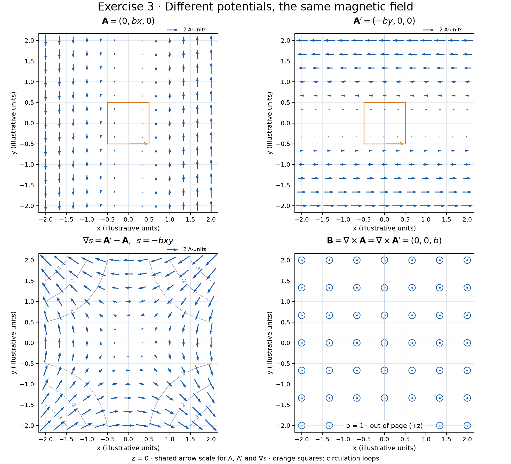
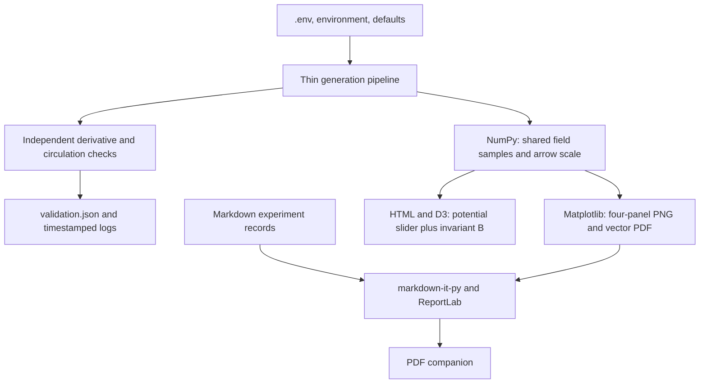

# Exercise 3: different potentials, the same magnetic field

## Methodology and use

This project turns the supplied electromagnetism exercise into scientific plots
and a gauge slider. It calculates both vector potentials on one xy grid, checks
their common curl and circulation independently, and renders the same samples
in static and interactive views. The [worked explanation](docs/explanation.md)
shows why different arrows describe the same magnetic field; the
[screenshot transcription](docs/source-extract.md) keeps quoted source text separate.

From a clone, run `uv sync --locked`, then **`uv run gauge-fields`**. Open
`outputs/exercise-3-interactive.html` in a browser and move its slider with the
mouse, touch, or keyboard. Home/End select the exercise's endpoints; arrow keys
change the gauge in steps of 0.01. At 0.50 the potential is rotationally symmetric.



## Install and reproduce

Requirements: [uv](https://docs.astral.sh/uv/getting-started/installation/), Git,
and access to this private repository. uv provisions Python 3.12 when needed
and creates `.venv` in this directory. The lockfile fixes Python dependency
versions. No API key or service account is required to generate the artifacts.

```bash
git clone https://github.com/BurnyCoder/curl.git
cd curl
uv sync --locked
uv run gauge-fields
```

The generator must run from the repository root so it can read `reports/`.
Internet access is needed for initial dependency installation. The interactive
file loads pinned D3 7.9.0 from jsDelivr; its chart needs access to that CDN.
PNG, PDF, source documentation, and Python calculations work offline once their
dependencies are installed. If D3 fails to load, the interactive view shows an
error and disables the slider. No browser server or backend is required.

For generation without development/test dependencies, use
`uv sync --locked --no-dev` and `uv run --no-dev gauge-fields`.

## Configuration

Copy `.env.example` to `.env` (for example, `cp .env.example .env` in Bash), then
edit its values. Process environment settings override `.env`; missing values
use the defaults below. `.env` is intentionally ignored by Git.

| Setting | Default | Meaning and supported range |
| --- | --- | --- |
| `GAUGE_B` | `1` | Finite uniform field strength, −100 to 100; zero and negative values are supported. |
| `GAUGE_EXTENT` | `2` | Sample both x and y from minus to plus this value; 0.1 to 10. |
| `GAUGE_POINTS` | `13` | Odd number of samples per coordinate, 5 to 25. |
| `GAUGE_OUTPUT` | `outputs` | Artifact directory, relative to the working directory or absolute. |

The plot uses z=0 and illustrative units. All three planar fields use one arrow
scale, and the slider retains it. B uses out-of-page dots for positive values,
inward crosses for negative values, and no symbols for zero. Across separate
runs the common arrow scale can change to keep figures readable.

## Features and outputs

| Artifact | Purpose |
| --- | --- |
| [Scientific figure: PNG](outputs/exercise-3-fields.png) | Four panels comparing the two potentials, their gradient difference, and B. |
| [Scientific figure: vector PDF](outputs/exercise-3-fields.pdf) | Scalable figure for printing or reuse. |
| [Interactive view](outputs/exercise-3-interactive.html) | Portable browser file with native keyboard support and a responsive slider. Download/open it locally; GitHub does not execute HTML previews. |
| `outputs/exercise-3-gauge.html` | The same interactive source as a fragment for conversation rendering. |
| [PDF companion](outputs/exercise-3-report.pdf) | Experiment summary, individual records, acceptance evidence when present, and the current figure. |
| [Numerical evidence](outputs/validation.json) | Actual maximum residuals from the independent validation phase. |
| `logs/generate-*.log` | Timestamped UTC generation phases, warnings, and exceptions, also streamed to the terminal. |

Generated default artifacts are committed for immediate reading. Running the
command replaces artifacts with the same names in the selected output directory.
Raw logs, browser screenshots, caches, and `.venv` are local and ignored; curated
experiment evidence lives in [reports](reports/summary.md). PDF metadata and log
timestamps naturally differ between runs.

## Architecture and technologies



Python's standard logging supplies file/terminal diagnostics; python-dotenv
loads optional configuration. pytest checks the model and command, pypdf and
Pillow inspect outputs, and Playwright verifies a separate Chromium browser.
There is no web framework, database, AI API, or hosted service in the pipeline.

## Verify and develop

```bash
# Physics, configuration, and complete generation/export checks:
uv run pytest -m "not browser" -q

# Install the test browser, then include native interaction and responsive checks:
uv run playwright install chromium --only-shell
uv run pytest -q
```

Minimal Linux installations may need Playwright's documented
[browser system dependencies](https://playwright.dev/python/docs/browsers#install-system-dependencies).
Browser checks use a separate headless Chromium instance; they do not attach to
a personal browser. They also need the D3 CDN. Test artifacts are generated in
pytest temporary directories, so negative and zero field tests do not overwrite
the default deliverables. Screenshots are saved under `test-results/` and browser
console records under `logs/browser-*.log`.

Tests cover the two endpoints, symmetric midpoint, connecting gradient,
constant curl, magnetic flux/circulation, invalid settings, shared export data,
PDF content, keyboard use, unchanged B geometry, and phone-sized layouts. See
[the experiment record](reports/summary.md) for methods, failures, fixes, and
measured results; [AGENTS.md](AGENTS.md) defines repository maintenance rules.

## Sources

- [User-supplied screenshot](docs/source/exercise-3.png): Exercise 3 and the quoted explanation; book metadata is not visible.
- [MIT electromagnetism solutions, page 6](https://web.mit.edu/8.286/www/quiz22/q3sols-euf22.pdf): gauge invariance and closed-loop circulation.
- [Matplotlib quiver](https://matplotlib.org/stable/api/_as_gen/matplotlib.pyplot.quiver.html), [NumPy gradient](https://numpy.org/doc/stable/reference/generated/numpy.gradient.html), and [D3 selections](https://d3js.org/d3-selection): numerical/rendering APIs.
- [uv projects](https://docs.astral.sh/uv/guides/projects/), [python-dotenv](https://bbc2.github.io/python-dotenv/), and [Python logging](https://docs.python.org/3/howto/logging.html): reproducible setup and diagnostics.
- [markdown-it-py](https://markdown-it-py.readthedocs.io/en/latest/using.html), [ReportLab Platypus](https://docs.reportlab.com/reportlab/userguide/ch5_platypus/), and [Playwright](https://playwright.dev/python/docs/library): report generation and browser verification.
